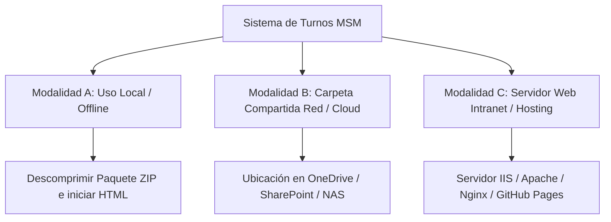

# 📘 Guía de Instalación, Despliegue y Puesta a Disposición
## Sistema de Programación de Turnos y Consola DOE — Mundo Salud Médica

---

## 📌 1. Visión General de Arquitectura

El **Sistema de Programación de Turnos** de Mundo Salud Médica es una plataforma web ligera construida bajo arquitectura **Client-Side (Zero-Install)**.

* **Sin Instalación de Servidores:** No requiere instalar Node.js, Python, bases de datos SQL ni motores pesados.
* **Compatibilidad Multiplataforma:** Opera en cualquier sistema operativo (Windows, macOS, Linux, iOS/Android) mediante un navegador web estándar.
* **Seguridad de Datos:** La información se procesa de forma privada y local en la memoria del navegador.

---

## 💻 2. Requisitos del Sistema

### Requisitos de Software
* **Navegador Web Recomendado:** Google Chrome (v90+), Microsoft Edge (v90+), Mozilla Firefox (v88+), Safari (v14+).
* **Visor de Hojas de Cálculo (Opcional):** Microsoft Excel 2016+, LibreOffice Calc o Google Sheets para abrir los archivos exportados `.xlsx`.

### Requisitos de Hardware
* **Procesador:** Cualesquiera compatible con navegación web básica.
* **Memoria RAM:** Mínimo 2 GB.
* **Pantalla:** Adaptación visual **responsive** desde 768px hasta resoluciones 4K.

---

## 🚀 3. Modalidades de Puesta a Disposición para Uso Institucional

Dependiendo de la infraestructura de TI de la organización, el sistema se puede poner a disposición mediante tres modalidades:



---

### 📂 Modalidad A: Uso Local / Offline (Archivos Únicos Autónomos .html)

Ideal para enviar por correo electrónico o entregar en memoria USB a los coordinadores de las Unidades Operativas.

#### ✨ Nueva Característica: Aplicaciones HTML de Archivo Único (Standalone)
Los archivos `Generador_Turnos_Unidades.html` y `Consola_DOE.html` han sido integrados como **aplicaciones web de archivo único**.
* Todo el diseño visual (CSS) y la lógica de programación (JS) están contenidos dentro del mismo archivo `.html`.
* **Ventaja:** No dependen de carpetas externas ni de otros archivos. Se pueden mover a cualquier ubicación (Escritorio, USB, Descargas) y al abrirse **nunca se verán desestructurados ni sin diseño**.

---

### 🛡️ Soluciones para Envío por Correo Electrónico (Evitar Bloqueos de Seguridad de Outlook / Gmail / Defender)

Los filtros de seguridad de correo institucional (Exchange, Outlook, Defender for Office 365) suelen bloquear archivos `.zip` que contienen scripts o programas por políticas antivirus corporativas. Para enviar las herramientas por correo sin que el antivirus las desactive, utiliza cualquiera de los siguientes tres métodos:

#### 🟢 Método 1: Enviar como enlace de OneDrive / SharePoint (Recomendado)
1. Sube los archivos o la carpeta a tu **OneDrive** o **SharePoint** institucional.
2. Genera un enlace de lectura ("Copiar Enlace").
3. Pega el enlace en el cuerpo del correo. **Ningún filtro de correo bloqueará el mensaje.**

#### 🟡 Método 2: Usar los archivos renombrados `.zip.txt` (Para adjuntar directo)
En la carpeta [`docs/`](file:///c:/Users/nicol/OneDrive/Mundo%20Salud%20M%C3%A9dica/PROYECTO%20MSM/Programacion_Turnos/docs/) se incluyeron las versiones especiales para correo:
* [`docs/Herramienta_Unidades_Para_Correo.zip.txt`](file:///c:/Users/nicol/OneDrive/Mundo%20Salud%20M%C3%A9dica/PROYECTO%20MSM/Programacion_Turnos/docs/Herramienta_Unidades_Para_Correo.zip.txt)
* [`docs/Herramienta_DOE_Para_Correo.zip.txt`](file:///c:/Users/nicol/OneDrive/Mundo%20Salud%20M%C3%A9dica/PROYECTO%20MSM/Programacion_Turnos/docs/Herramienta_DOE_Para_Correo.zip.txt)

**Instrucción para el destinatario:**
1. Descargar el adjunto `.zip.txt`.
2. Renombrar el archivo quitándole el `.txt` al final (dejándolo como `.zip`).
3. Descomprimir normalmente.

#### 🔵 Método 3: Comprimir con contraseña (Cifrado de ZIP)
1. Al crear el archivo `.zip`, asígnale una contraseña sencilla (ejemplo: `msm2026`).
2. Al estar cifrado con clave, el filtro antivirus de Outlook no podrá escanear el interior del `.zip` y lo dejará pasar sin bloqueos.

---

### 💬 Envío Rápido por WhatsApp (WhatsApp Web / Móvil)

**¡Sí, es 100% compatible!** A diferencia del correo electrónico corporativo, WhatsApp no aplica restricciones ni bloquea el envío de archivos `.html` o `.zip`.

#### 🚀 Cómo enviarlo por WhatsApp en 2 pasos:
1. En el chat de WhatsApp (Web o Móvil), haz clic en el ícono de **Adjuntar 📎** > **Documento**.
2. Selecciona directamente el archivo autónomo:
   * `Generador_Turnos_Unidades.html` (para programadores de servicio)
   * `Consola_DOE.html` (para auditores)
   * O el archivo `.zip` (`Herramienta_Unidades.zip` / `Herramienta_DOE.zip`)
3. **Experiencia del destinatario:** El usuario descarga el archivo `.html` en su computador, le da doble clic y la herramienta abre instantáneamente en su navegador web con **100% de su diseño y funcionalidad**, sin necesidad de descomprimir nada.

---

### 🌐 Modalidad B: Carpeta Compartida en Red / Nube (SharePoint / OneDrive / NAS)

Ideal para que todo el equipo acceda desde una ruta de red unificada sin distribuir múltiples copias.

1. Copiar la carpeta completa del proyecto `Programacion_Turnos` en una unidad de red institucional (ejemplo: `\\NAS_MSM\Publico\Programacion_Turnos\`) o sincronizada con Microsoft OneDrive / SharePoint.
2. Compartir el acceso directo al portal de inicio [`index.html`](file:///c:/Users/nicol/OneDrive/Mundo%20Salud%20M%C3%A9dica/PROYECTO%20MSM/Programacion_Turnos/index.html).
3. Los usuarios harán clic en `index.html` y accederán de forma inmediata al portal centralizado.

---

### 🌐 Modalidad C: Despliegue en Servidor Web Intranet (IIS / Apache / Nginx / GitHub Pages)

Ideal para publicar la aplicación bajo un dominio o subdominio interno de la empresa (ejemplo: `https://turnos.mundosaludmedica.com`).

#### Despliegue en Internet Information Services (IIS - Windows Server):
1. Abrir el Administrador de IIS (`inetmgr`).
2. Crear un nuevo **Sitio Web** o **Aplicación** apuntando a la ruta física `C:\inetpub\wwwroot\Programacion_Turnos`.
3. Asegurar que `index.html` esté configurado como documento predeterminado.

#### Despliegue en GitHub Pages / Vercel / Netlify:
1. En el repositorio de GitHub, ir a **Settings** > **Pages**.
2. Seleccionar la rama `main` y la carpeta raíz `/root`.
3. Guardar. El sistema estará disponible públicamente en `https://<usuario>.github.io/Programacion_Turnos/`.

---

## 🛠️ 4. Estructura de Archivos del Proyecto

```text
Programacion_Turnos/
├── index.html                                # Portal de inicio y navegación central (Hub)
├── README.md                                 # Presentación general del proyecto
├── INSTRUCCIONES_DESPLIEGUE_E_INSTALACION.md # Guía de despliegue e instalación (este documento)
│
├── app_unidad/                               # Módulo para Unidades Operativas
│   ├── Generador_Turnos_Unidades.html        # Aplicación del Programador de Turnos
│   ├── Manual_Usuario_Unidades.html          # Manual interactivode usuario Unidades
│   ├── app.js                                # Motor de matriz, horas y exportación Excel
│   └── styles.css                            # Estilos responsive Glassmorphism (Unidades)
│
├── app_doe/                                  # Módulo para la Dirección de Operaciones
│   ├── Consola_DOE.html                      # Aplicación de la Consola DOE
│   ├── Manual_Usuario_DOE.html               # Manual interactivo de auditoría DOE
│   ├── app.js                                # Motor de auditoría, desambiguación y consolidación
│   └── styles.css                            # Estilos responsive Glassmorphism (DOE)
│
└── docs/                                     # Documentación institucional y paquetes ZIP
    ├── CIRCULAR 010-2026...pdf               # Normativa oficial de turnos 2026
    ├── Herramienta_Unidades.zip              # Paquete ZIP distribuible Unidades
    └── Herramienta_DOE.zip                   # Paquete ZIP distribuible DOE
```

---

## 📦 5. Procedimiento para Empaquetar Nuevas Versiones (ZIP)

Si se realizan futuras modificaciones al código y se desea actualizar los archivos distribuibles `.zip` en la carpeta `docs/`:

1. En Windows PowerShell, navegar a la carpeta del proyecto y ejecutar:
   ```powershell
   Compress-Archive -Path "app_unidad\*" -DestinationPath "docs\Herramienta_Unidades.zip" -Force
   Compress-Archive -Path "app_doe\*" -DestinationPath "docs\Herramienta_DOE.zip" -Force
   ```
2. Los archivos `.zip` quedarán listos para su distribución a las Unidades Operativas y auditores DOE.

---

<p align="center"><b>Mundo Salud Médica © 2026</b><br>Dirección de Operaciones y Enfermería (DOE)</p>
